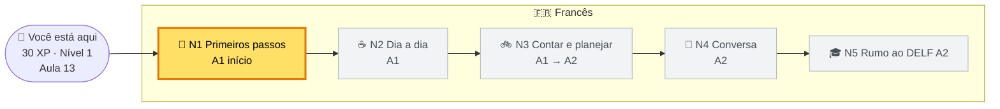
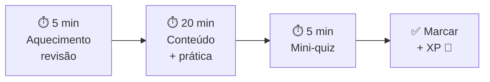

# 🇫🇷 Francês da Thaís

O hub de estudos de francês da **Thaís**: do zero ao **A1/A2**. 🇧🇷 🇵🇹 → 🇫🇷

**Regra de ouro:** 1 aula por dia de estudo. 30 minutos. Só isso.

Pouco todo dia vence muito de vez em quando. 🌱

🌐 Prefere ler no navegador, com áudio tocando direto na página? Veja o [site do curso](docs/index.html) (pasta `docs/`).

🃏 Cartões de memória com áudio no celular: veja o [guia do Anki](anki.md) e baixe o deck do curso.

🧭 Já sabe um pouco de francês? Faça o [teste de nivelamento](nivelamento.md) (15–20 min, no chat) para descobrir em que aula começar.

## 🧠 Como o sistema funciona

- O curso tem **5 níveis** (do A1 início ao A2).
- Cada nível tem **aulas de 30 min**.
- A cada bloco de aulas vem **1 revisão** 🔁.
- No fim de cada nível há um **checkpoint** (um mini desafio).
- Cada aula dá **XP**. O XP sobe o seu título. Ver [gamificacao.md](gamificacao.md).
- Esquecer é normal. Por isso existe **revisão espaçada** (1, 3, 7 e 14 dias).
- Toda palavra e frase importante tem **áudio com voz francesa** 🔊. Ouça e repita!

## 🗺️ Mapa

🟨 Amarelo = onde você está agora.

## 📊 Painel

Atualizado em: 2026-11-04 (dia 1: Aulas 01 e 02 concluídas 🎉, os dois mini-quizzes com 100% 💯, [nivelamento](nivelamento.md) feito: começa na Aula 13 🧭).

| Assunto | Nível atual | Aula atual | Progresso | XP | Streak |
| --- | --- | --- | --- | --- | --- |
| 🇫🇷 [Francês](roadmap.md) | N1 · Primeiros passos | [Aula 13](aulas/aula-13.md) | ⬜⬜⬜⬜⬜⬜⬜⬜⬜⬜ 2% (2/110) | 30 | 1 |

**Total:** 30 XP · Título: 🥐 Croissant Curioso (próximo: ☕ Freguesa do Café aos 100 XP, faltam 70) · Streak: 1 dia · Coringas: 🃏🃏

- **Progresso** = aulas feitas ÷ 110 aulas do curso inteiro.
- Cada ⬛ = 10%.
- Aulas 03–12 foram **puladas pelo nivelamento**: não contam como feitas nem dão XP.
- Regras de XP e streak: [gamificacao.md](gamificacao.md).

## 📚 Aulas prontas

| Aula | Tema | Status |
| --- | --- | --- |
| [01](aulas/aula-01.md) | 👄 Os sons do francês | ✅ |
| [02](aulas/aula-02.md) | 👋 Cumprimentos e apresentar-se | ✅ |
| [03](aulas/aula-03.md) | 📦 Artigos e gênero | ⏭️ pulada (consulta) |
| [04](aulas/aula-04.md) | 🧱 être e avoir | ⏭️ pulada (consulta) |
| [05](aulas/aula-05.md) | 🔢 Números de 0 a 100 | ⏭️ pulada (consulta) |
| [06](aulas/aula-06.md) | 🧭 Preposições do dia a dia | ⏭️ pulada (consulta) |
| 07–12 | Revisão 1, verbos -er, perguntas, nacionalidades, café, Revisão 2 | ⏭️ puladas (resumo na [Aula 13](aulas/aula-13.md#-ponte-o-que-você-pulou-aulas-0712)) |
| [13](aulas/aula-13.md) | 🎵 Sons II: é, è, ê e o e mudo | 👉 próxima |
| [14](aulas/aula-14.md) | 👂 Ouvir de verdade | ⬜ |
| [15](aulas/aula-15.md) | 🔁 Revisão 3 + ensaio do checkpoint | ⬜ |
| [16](aulas/aula-16.md) | 🏁 Checkpoint N1 | ⬜ |
| [17](aulas/aula-17.md) | 👨‍👩‍👧 A família e os possessivos I (mon, ma, mes) | ⬜ |
| [18](aulas/aula-18.md) | 🚇 aller e prendre | ⬜ |
| [19](aulas/aula-19.md) | 🚴 faire, o -es do tu e a elisão | ⬜ |
| [20](aulas/aula-20.md) | 🔁 Revisão 1 do N2 (aulas 17–19) | ⬜ |

As próximas estão no [plano de estudo](plano-de-estudo.md).

## 📅 Rotina semanal

Sugestão (troque à vontade):

| Dia | O quê |
| --- | --- |
| Seg | 📗 Aula nova |
| Ter | 📗 Aula nova |
| Qua | 🌴 Folga (ou aula mini) |
| Qui | 📗 Aula nova |
| Sex | 📗 Aula nova |
| Sáb | 🎧 Leve: ouvir os áudios da semana, um vídeo em francês |
| Dom | 🔁 Revisões espaçadas pendentes + atualizar o painel |

- São **4 aulas por semana**. Assim o curso todo leva **~7 meses**.
- Domingo sem revisões pendentes? **Descanso.** Conta como dia feito ✅.
- O importante é fazer **uma** aula. Trocar dias é permitido.

## ⏱️ Como é uma sessão (30 min)

1. Abra o [progresso.md](progresso.md). Há revisão pendente para hoje? Faça no aquecimento.
2. Abra a aula. Ligue um **timer de 30 min**.
3. Leia **em voz alta** e toque os áudios 🔊.
4. Faça os exercícios e confira no gabarito.
5. Faça o mini-quiz. Sem espiar a resposta 😉.
6. Marque ✅ no [plano-de-estudo.md](plano-de-estudo.md) e escreva 1 linha no [progresso.md](progresso.md).
7. Comemore. Você fez. 🎉

**Dia difícil?** Faça a **versão mini**: 10 min, só o aquecimento + 1 exercício.

Vale 5 XP e mantém o streak.

## 📁 Arquivos

| Arquivo | O que é |
| --- | --- |
| [roadmap.md](roadmap.md) | Os 5 níveis, os checkpoints e o caminho até o A2 |
| [anki.md](anki.md) | Guia do Anki no Android + o deck do curso (.apkg) com áudio |
| [nivelamento.md](nivelamento.md) | Teste de nivelamento A1 → A2 (no chat) com gabarito e regra de onde começar |
| [plano-de-estudo.md](plano-de-estudo.md) | A lista de aulas com ✅ |
| [progresso.md](progresso.md) | O diário e as revisões |
| [gamificacao.md](gamificacao.md) | XP, títulos, conquistas e streak |
| [aulas/](aulas/aula-01.md) | O conteúdo das aulas, com áudios em `aulas/assets/` |
| `docs/` | O site do curso (GitHub Pages) |
| `scripts/` | Ferramentas: gerar áudios e o site |

## 🧩 Princípios de ensino

- **Um pedaço de cada vez.** Uma ideia por bloco.
- **Porquê primeiro.** Antes do como, o porquê.
- **Ouvir e falar.** Toda palavra nova tem áudio. Repita em voz alta.
- **O português ajuda.** Primos de língua, contrações iguais, e o "tu" de Portugal. 🇵🇹
- **Fazer > ler.** Toda aula tem prática e gabarito.
- **Errar faz parte.** Quiz serve para lembrar, não para julgar.
- **Sem castigo.** Faltou um dia? Recomeça. Nada se perde.

## 🛠️ Para quem mantém o curso

- **Áudios:** `python3 scripts/gerar_audios.py` (usa `edge-tts`, voz `fr-FR-DeniseNeural`, velocidade -20%). As frases ficam em `scripts/audios.tsv`.
- **Anki:** `python3 scripts/gerar_anki.py` lê `scripts/anki_vocab.tsv` e gera `docs/anki/frances-thais.apkg` (precisa de `genanki`). Ver [anki.md](anki.md).
- **Site:** `python3 scripts/build_site.py` gera o `docs/` a partir dos `.md` (precisa de `pip install markdown`). O resultado já vem pronto no repositório: o GitHub Pages **não precisa** de build.
- **Testar o site:** `python3 -m http.server -d docs 8000` e abra <http://localhost:8000>.
