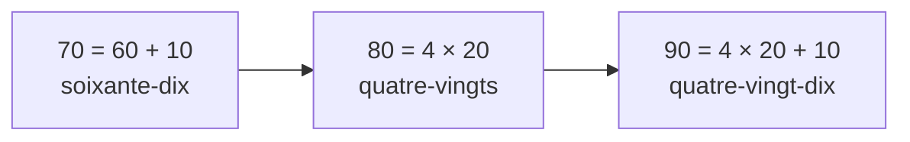

# 🇫🇷 Aula 05 · Números de 0 a 100 (e preços em euros)

Nível 1 · Bloco A · ⏱️ 30 min · ⭐ 10 XP

[← Anterior](aula-04.md) · [Plano](../plano-de-estudo.md) · [Próxima →](aula-06.md)

## 🎯 Objetivo

- Contar de **0 a 20** sem olhar.
- Entender as dezenas até **100**, incluindo o famoso **quatre-vingts** (80).
- Dizer a idade e entender preços.

## 🤔 Por que isso importa

Números estão em tudo: preço, hora, idade, telefone, número da casa. 🔢

Até 69 o francês é bem regular.

Depois vem a parte "matemática": 80 = **4 × 20**. 🤯 Mas tem lógica, prometo.

---

## ⏱️ 5 min · Aquecimento

Recite **être** e **avoir** (aula 04) em voz alta:

- je suis, tu es, il est… · j'ai, tu as, il a…

E diga: **J'ai … ans.** (a sua idade, em português mesmo; no fim da aula você diz em francês!)

---

## ⏱️ 20 min · Conteúdo + prática

🗣️ Leia **tudo em voz alta**. Sempre.

### 1️⃣ De 0 a 10

| Nº | Francês | Fala (aprox.) |
| --- | --- | --- |
| 0 | zéro | "zerô" |
| 1 | un / une | "ẽ" / "ün" |
| 2 | deux | "dê" (biquinho) |
| 3 | trois | "truá" |
| 4 | quatre | "katr" |
| 5 | cinq | "sénk" (nasal) |
| 6 | six | "siss" |
| 7 | sept | "sét" |
| 8 | huit | "uít" |
| 9 | neuf | "nêf" |
| 10 | dix | "diss" |

🔊 [0 a 10 em sequência](assets/aula-05/audio/0-10.mp3) · [zéro](assets/aula-05/audio/zero.mp3) · [un](assets/aula-05/audio/un.mp3) · [deux](assets/aula-05/audio/deux.mp3) · [trois](assets/aula-05/audio/trois.mp3) · [quatre](assets/aula-05/audio/quatre.mp3) · [cinq](assets/aula-05/audio/cinq.mp3) · [six](assets/aula-05/audio/six.mp3) · [sept](assets/aula-05/audio/sept.mp3) · [huit](assets/aula-05/audio/huit.mp3) · [neuf](assets/aula-05/audio/neuf.mp3) · [dix](assets/aula-05/audio/dix.mp3)

💡 **un** com coisa masculina, **une** com feminina: *un café*, *une tarte*.

### 2️⃣ De 11 a 20

| Nº | Francês | Nº | Francês |
| --- | --- | --- | --- |
| 11 | onze | 16 | seize |
| 12 | douze | 17 | dix-sept |
| 13 | treize | 18 | dix-huit |
| 14 | quatorze | 19 | dix-neuf |
| 15 | quinze | 20 | vingt ("vẽ") |

🔊 [11 a 20 em sequência](assets/aula-05/audio/11-20.mp3)

💡 Até 16 são palavras próprias (parecem o português: *onze, doze, treze…*).

De 17 a 19 é soma: **dix-sept** = 10 + 7.

### 3️⃣ As dezenas até 60

| Nº | Francês |
| --- | --- |
| 20 | vingt |
| 30 | trente |
| 40 | quarante |
| 50 | cinquante |
| 60 | soixante ("suassãnt") |

🔊 [20, 30, 40, 50, 60](assets/aula-05/audio/dezenas.mp3)

Para montar: dezena + **hífen** + unidade.

- 23 = **vingt-trois** · 45 = **quarante-cinq** · 58 = **cinquante-huit**

⚠️ Com **1** usa-se **et** (e): 21 = **vingt et un**, 31 = **trente et un**.

🔊 [vingt-trois](assets/aula-05/audio/vingt-trois.mp3) · [vingt et un](assets/aula-05/audio/vingt-et-un.mp3) · [quarante-cinq](assets/aula-05/audio/quarante-cinq.mp3)

### 4️⃣ 70, 80, 90: a matemática francesa 🧮

| Nº | Francês | Lógica |
| --- | --- | --- |
| 70 | soixante-dix | 60 + 10 |
| 71 | soixante et onze | 60 + 11 |
| 75 | soixante-quinze | 60 + 15 |
| 80 | quatre-vingts | 4 × 20 |
| 81 | quatre-vingt-un | 4 × 20 + 1 |
| 90 | quatre-vingt-dix | 4 × 20 + 10 |
| 99 | quatre-vingt-dix-neuf | 4 × 20 + 19 |
| 100 | cent | "sã" |

🔊 [soixante-dix](assets/aula-05/audio/70.mp3) · [soixante et onze](assets/aula-05/audio/71.mp3) · [quatre-vingts](assets/aula-05/audio/80.mp3) · [quatre-vingt-dix](assets/aula-05/audio/90.mp3) · [quatre-vingt-dix-neuf](assets/aula-05/audio/99.mp3) · [cent](assets/aula-05/audio/100.mp3)

💡 Curiosidade: na Bélgica e na Suíça dizem **septante** (70) e **nonante** (90). Bem mais fácil! 🇧🇪 🇨🇭

### 5️⃣ Idade e preço

| Francês | Português |
| --- | --- |
| **Tu as quel âge ?** | Quantos anos tu tens? |
| **J'ai vingt-neuf ans.** | Tenho 29 anos. |
| **C'est combien ?** | Quanto custa? |
| **Ça fait cinq euros.** | Dá 5 euros. |
| **Deux euros cinquante.** | 2,50 € (dois euros e cinquenta). |

🔊 [Tu as quel âge ?](assets/aula-05/audio/quel-age.mp3) · [J'ai vingt-neuf ans.](assets/aula-05/audio/29-ans.mp3) · [C'est combien ?](assets/aula-05/audio/cest-combien.mp3) · [Ça fait cinq euros.](assets/aula-05/audio/cinq-euros.mp3) · [Deux euros cinquante.](assets/aula-05/audio/2-50.mp3)

⚠️ Ligação com **euros** e **ans**: *deux euros* = "dêzêrô", *trois ans* = "truazã".

E um especial: **neuf ans** = "nêvã" (o F vira V!).

### 6️⃣ Telefone: de dois em dois 📱

Na França, o telefone é lido **em pares**:

- 06 12 34 56 78 = *zéro six, douze, trente-quatre, cinquante-six, soixante-dix-huit*

🔊 [Ouvir o telefone](assets/aula-05/audio/telefone.mp3)

🎧 Tudo em sequência: [todos os áudios da aula](assets/aula-05/audio/todos.mp3)

---

## ✋ Prática

- [ ] Conte de 0 a 20 **em voz alta**, 2 vezes. Depois de trás para frente. 🔁
- [ ] Na próxima ida ao Pingo Doce ou ao Continente, leia os preços **em francês**, de cabeça. 🛒
- [ ] **Exercício A · Escreva por extenso:**
  1. 7
  2. 14
  3. 21
  4. 36
  5. 80
  6. 92
- [ ] **Exercício B · Qual número?**
  1. soixante-cinq
  2. quarante-huit
  3. soixante-dix-sept
  4. quatre-vingt-quatre
- [ ] **Exercício C · Traduza:**
  1. Tenho 34 anos.
  2. Quanto custa? — Dá 12 euros.

✅ Gabarito dos exercícios

**A.** 1. sept · 2. quatorze · 3. vingt et un · 4. trente-six · 5. quatre-vingts · 6. quatre-vingt-douze

**B.** 1. 65 · 2. 48 · 3. 77 (60 + 17) · 4. 84 (4 × 20 + 4)

**C.**

1. **J'ai trente-quatre ans.**
2. **C'est combien ? — Ça fait douze euros.**

---

## ⏱️ 5 min · Mini-quiz

1. Como se diz 15?
2. E 21? (cuidado com o "e")
3. 70 em francês da França é…?
4. **quatre-vingts** é quanto?
5. Como perguntar o preço?
6. Como se lê *neuf ans*?

👀 Ver respostas

1. **quinze**
2. **vingt et un**
3. **soixante-dix** (60 + 10)
4. **80** (4 × 20)
5. **C'est combien ?**
6. **"nêvã"**: o F vira V.

Acertou tudo? **+5 XP** 💯

---

## 🔗 Para ir mais longe (opcional)

- [RFI — Français facile](https://francaisfacile.rfi.fr/)
- [Forvo — ouça números falados por nativos](https://forvo.com/languages/fr/)

## ✅ Concluí

- [ ] Conto de 0 a 20 sem olhar
- [ ] Entendo 70, 80 e 90
- [ ] Digo a minha idade em francês
- [ ] Registrei no [progresso](../progresso.md)

🎉 **+10 XP.** Conquista: 🔢 **Quatre-Vingts** (ver [gamificação](../gamificacao.md))
