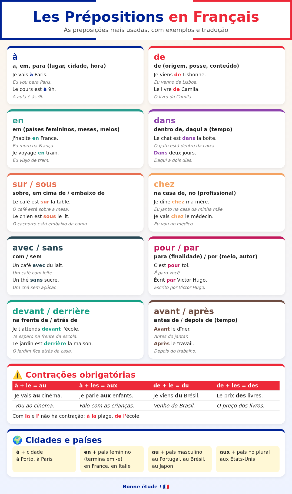

# 🇫🇷 Aula 06 · Preposições: à, de, en, dans, chez…

Nível 1 · Bloco A · ⏱️ 30 min · ⭐ 10 XP

[← Anterior](aula-05.md) · [Plano](../plano-de-estudo.md)

## 🎯 Objetivo

- Usar as **preposições do dia a dia**: à, de, en, dans, sur, sous, chez, avec, sans, pour.
- Fazer as **contrações obrigatórias**: au, aux, du, des.
- Dizer **em que cidade e país** você está: *à Porto, au Portugal, en France*.

## 🤔 Por que isso importa

Preposições são as "colinhas" da frase. 🧩

Sem elas, não dá para dizer **onde**, **com quem** nem **para quê**.

Boa notícia: muitas funcionam **como no português** (*de* = de, *avec* = com).

E as contrações você já conhece: *ao, do, dos*. O francês faz igual! 🇧🇷

---

## ⏱️ 5 min · Aquecimento

Revise a aula 05 em voz alta:

- Conte de **10 a 20**.
- Diga a sua idade: **J'ai … ans.**
- Pergunte o preço: **C'est combien ?**

---

## ⏱️ 20 min · Conteúdo + prática

🗣️ Leia **tudo em voz alta**. Sempre.

🖼️ Deixe o **infográfico** aberto ao lado. Ele é o seu mapa desta aula:

📄 Versão para imprimir (A4, 2 páginas, com mais preposições): [infografico_preposicoes_A4.pdf](assets/aula-06/infografico_preposicoes_A4.pdf) · [página 1 (PNG)](assets/aula-06/img/infografico_preposicoes_A4_p1.png) · [página 2 (PNG)](assets/aula-06/img/infografico_preposicoes_A4_p2.png)

### 1️⃣ à e de: as duas mais usadas

| Preposição | Sentido | Exemplo | Tradução |
| --- | --- | --- | --- |
| **à** | a, em, para (lugar, hora) | Je vais **à** Paris. | Vou para Paris. |
| | | Le cours est **à** 9 h. | A aula é às 9h. |
| **de** | de (origem, posse) | Je viens **de** Porto. | Venho do Porto. |
| | | Le livre **de** Camila. | O livro da Camila. |

🔊 [Je vais à Paris.](assets/aula-06/audio/je-vais-a-paris.mp3) · [Le cours est à neuf heures.](assets/aula-06/audio/cours-9h.mp3) · [Je viens de Porto.](assets/aula-06/audio/je-viens-de-porto.mp3) · [Le livre de Camila.](assets/aula-06/audio/livre-de-camila.mp3)

### 2️⃣ As contrações obrigatórias ⚠️

Igualzinho a "a + o = **ao**" e "de + o = **do**":

| Junta | Vira | Exemplo | Tradução |
| --- | --- | --- | --- |
| à + le | **au** | Je vais **au** cinéma. | Vou ao cinema. |
| à + les | **aux** | Je parle **aux** enfants. | Falo com as crianças. |
| de + le | **du** | Je viens **du** Brésil. | Venho do Brasil. |
| de + les | **des** | Le prix **des** livres. | O preço dos livros. |

🔊 [Je vais au cinéma.](assets/aula-06/audio/au-cinema.mp3) · [Je parle aux enfants.](assets/aula-06/audio/aux-enfants.mp3) · [Je viens du Brésil.](assets/aula-06/audio/du-bresil.mp3) · [Le prix des livres.](assets/aula-06/audio/des-livres.mp3)

Com **la** e **l'** não há contração:

- **à la** plage (à praia) · **à l'**école (à escola) · **de la** pharmacie · **de l'**hôtel

🔊 [à la plage](assets/aula-06/audio/a-la-plage.mp3) · [à l'école](assets/aula-06/audio/a-lecole.mp3)

### 3️⃣ Cidades e países 🌍

| Regra | Exemplos |
| --- | --- |
| **à** + cidade | à Lisbonne, à Porto, à Paris |
| **en** + país feminino (quase sempre termina em **-e**) | en France, en Italie, en Espagne |
| **au** + país masculino | au Portugal, au Brésil, au Japon |
| **aux** + país no plural | aux États-Unis |

🔊 [J'habite à Porto, au Portugal.](assets/aula-06/audio/porto-portugal.mp3) · [Je suis née au Brésil.](assets/aula-06/audio/nee-au-bresil.mp3) · [Je voyage en France.](assets/aula-06/audio/voyage-en-france.mp3) · [Il habite aux États-Unis.](assets/aula-06/audio/etats-unis.mp3)

💡 Exceção famosa: **le Mexique** termina em -e, mas é masculino: *au Mexique*.

### 4️⃣ Onde está? 📍

| Preposição | Sentido | Exemplo |
| --- | --- | --- |
| **dans** | dentro de | Le chat est **dans** la boîte. (O gato está dentro da caixa.) |
| **sur** | em cima de | Le café est **sur** la table. (O café está sobre a mesa.) |
| **sous** | embaixo de | Le chien est **sous** le lit. (O cachorro está embaixo da cama.) |
| **devant** | na frente de | Je t'attends **devant** l'école. (Te espero na frente da escola.) |
| **derrière** | atrás de | Le jardin est **derrière** la maison. (O jardim fica atrás da casa.) |

🔊 [dans la boîte](assets/aula-06/audio/dans.mp3) · [sur la table](assets/aula-06/audio/sur.mp3) · [sous le lit](assets/aula-06/audio/sous.mp3) · [devant l'école](assets/aula-06/audio/devant.mp3) · [derrière la maison](assets/aula-06/audio/derriere.mp3)

💡 **sur** × **sous**: *sur* tem o som do **u biquinho** (aula 01!). *sous* tem o nosso "u".

### 5️⃣ chez: a preposição "da casa" 🏠

**chez** + pessoa = na casa de / no consultório de.

- Je dîne **chez** ma mère. — Janto na casa da minha mãe.
- Je vais **chez** le médecin. — Vou ao médico.

🔊 [Je dîne chez ma mère.](assets/aula-06/audio/chez-ma-mere.mp3) · [Je vais chez le médecin.](assets/aula-06/audio/chez-le-medecin.mp3)

⚠️ Lugar = **à** (*à la pharmacie*). Pessoa = **chez** (*chez le pharmacien*).

### 6️⃣ Com, sem, para ☕

| Preposição | Sentido | Exemplo |
| --- | --- | --- |
| **avec** | com | Un café **avec** du lait. (Um café com leite.) |
| **sans** | sem | Un thé **sans** sucre. (Um chá sem açúcar.) |
| **pour** | para | C'est **pour** toi. (É para ti / para você.) |
| **en** + transporte | de | Je voyage **en** train. (Viajo de trem.) |

🔊 [Un café avec du lait.](assets/aula-06/audio/avec.mp3) · [Un thé sans sucre.](assets/aula-06/audio/sans.mp3) · [C'est pour toi.](assets/aula-06/audio/pour.mp3) · [Je voyage en train.](assets/aula-06/audio/en-train.mp3)

💡 Na pastelaria: **Un galão sans sucre, s'il vous plaît !** 😄

🎧 Tudo em sequência: [todos os áudios da aula](assets/aula-06/audio/todos.mp3)

---

## ✋ Prática

- [ ] Ouça e repita os áudios, olhando o infográfico.
- [ ] **Exercício A · à, au, à la, à l' ou aux?**
  1. Je vais ___ cinéma.
  2. Elle est ___ plage.
  3. Nous allons ___ école.
  4. Il parle ___ enfants.
  5. J'habite ___ Porto.
- [ ] **Exercício B · de, du, de la ou des?**
  1. Je viens ___ Brésil.
  2. C'est le livre ___ Camila.
  3. Le prix ___ livres.
  4. Je sors ___ pharmacie.
- [ ] **Exercício C · en, au ou aux?**
  1. J'habite ___ Portugal.
  2. Je voyage ___ France.
  3. Ma sœur habite ___ États-Unis.
  4. Il est né ___ Japon.
- [ ] **Exercício D · Traduza:**
  1. O gato está embaixo da mesa.
  2. Janto na casa da Marie.
  3. Um café com leite e sem açúcar, por favor.

✅ Gabarito dos exercícios

**A.** 1. au (à + le) · 2. à la · 3. à l' · 4. aux (à + les) · 5. à (cidade)

**B.** 1. du (de + le) · 2. de · 3. des (de + les) · 4. de la

**C.** 1. au · 2. en · 3. aux · 4. au

**D.**

1. **Le chat est sous la table.**
2. **Je dîne chez Marie.**
3. **Un café avec du lait et sans sucre, s'il vous plaît.**

### 🖨️ Folha extra (para imprimir)

Quer mais? Há uma folha A4 com 3 blocos de exercícios e gabarito comentado:

- 📝 [Exercícios (PDF A4)](assets/aula-06/exercicios_preposicoes_A4.pdf)
- ✅ [Gabarito (PDF A4)](assets/aula-06/gabarito_preposicoes_A4.pdf)
- 📦 [Tudo junto: infográfico + exercícios + gabarito (PDF A4)](assets/aula-06/frances_preposicoes_completo_A4.pdf)

💡 A folha traz algumas preposições que **ainda não vimos** (*depuis, pendant, malgré, parmi, vers, selon…*). Elas estão na página 2 do infográfico A4. Faça agora o que der e guarde o resto para a revisão. Sem pressa. 🐢

---

## ⏱️ 5 min · Mini-quiz

1. à + le = ?
2. de + les = ?
3. Como dizer "Moro em Portugal"?
4. E "Vou para a França"?
5. "Na casa da minha mãe" = ?
6. *sur* ou *sous*: qual é "embaixo de"?

👀 Ver respostas

1. **au**
2. **des**
3. **J'habite au Portugal.**
4. **Je vais en France.**
5. **chez ma mère**
6. **sous** (com o "u" do português).

Acertou tudo? **+5 XP** 💯

---

## 🔗 Para ir mais longe (opcional)

- 🧩 Fontes editáveis (HTML) do material: [infográfico original](assets/aula-06/fonte/info.html) · [infográfico A4](assets/aula-06/fonte/infografico_preposicoes_A4.html) · [exercícios](assets/aula-06/fonte/exercicios_preposicoes_A4.html) · [gabarito](assets/aula-06/fonte/gabarito_preposicoes_A4.html)

- [TV5Monde — Apprendre le français](https://apprendre.tv5monde.com/)
- [WordReference — dicionário francês-português](https://www.wordreference.com/frpt/)

## ✅ Concluí

- [ ] Faço as contrações au, aux, du, des
- [ ] Sei usar à, en, au com cidades e países
- [ ] Sei dizer onde algo está (dans, sur, sous, devant, derrière)
- [ ] Registrei no [progresso](../progresso.md)

🎉 **+10 XP.** Conquista: 🧭 **Mapa na Mão** (ver [gamificação](../gamificacao.md))
