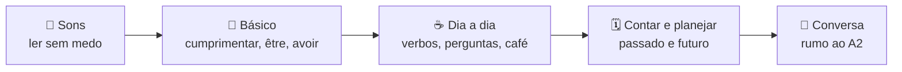
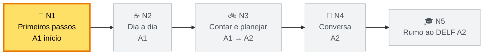

# 🇫🇷 Francês — Roadmap

Meta: **francês básico de verdade**, do zero até o **A1/A2** do Quadro Europeu (CEFR).

Para quem: a **Thaís**, brasileira, morando em Portugal, começando do zero. 🇧🇷 🇵🇹 → 🇫🇷

Volte ao [hub](README.md) · [Plano de estudo](plano-de-estudo.md) · [Progresso](progresso.md)

## 🤔 Por que nesta ordem

1. **Sons primeiro.** O francês escreve diferente do que fala. Sem isso, tudo fica difícil.
2. **Frases úteis logo cedo.** Na aula 02 você já se apresenta. Motivação lá em cima. 🚀
3. **Gramática em pedaços.** Uma regra por vez, sempre com exemplo real.
4. **O português ajuda.** Muitas palavras são primas. A gente aproveita isso o tempo todo.

## 📏 O que é A1 e A2?

| Nível | Em poucas palavras |
| --- | --- |
| **A1** | Apresentar-se, falar de si, pedir coisas simples, entender frases curtas e lentas. |
| **A2** | Falar da rotina, do passado e de planos; resolver situações do dia a dia (loja, médico, viagem). |

📝 A prova oficial é o **DELF** (A1, A2…). Fazer a prova é **opcional**. Em Portugal, o Institut français du Portugal coordena os exames e a Alliance Française de Lisboa aplica e prepara para a prova. Datas e locais: ver links no fim.

## 🗺️ Os 5 níveis

🟨 Amarelo = onde você está agora.

| Nível | Aulas | Tempo (≈ 4 aulas/semana) | CEFR |
| --- | --- | --- | --- |
| N1 · Primeiros passos | 16 | ~4 semanas | A1 início |
| N2 · Dia a dia | 20 | ~5 semanas | A1 |
| N3 · Contar e planejar | 24 | ~6 semanas | A1 → A2 |
| N4 · Conversa | 24 | ~6 semanas | A2 |
| N5 · Rumo ao DELF A2 | 26 | ~7 semanas | A2 |
| **Total** | **110** | **~7 meses** | |

💡 Ritmo mais lento? Sem problema. 2 aulas por semana = ~1 ano. O caminho é o mesmo. 🐢

### N1 · Primeiros passos 🥐

- Sons do francês: letras mudas, **u × ou**, nasais, R, ligação.
- Cumprimentar, **tu × vous**, apresentar-se.
- Artigos e gênero: le, la, les, un, une, des.
- **être** e **avoir**. Negação *ne… pas*.
- Números de 0 a 100. Preços e idade.
- Preposições do dia a dia: à, de, en, dans, chez… + au, du.
- Verbos em **-er** (parler, habiter, aimer). Perguntas simples.
- No café e na padaria: *je voudrais…, il y a…*

🏁 **Checkpoint 1:** apresentar-se em **1 minuto** sem ler + entender um diálogo curto de café.

### N2 · Dia a dia ☕

- Família, possessivos (mon, ma, mes).
- Dias, meses, horas. Rotina.
- Comida, café, padaria, supermercado: *je voudrais…*
- Verbos **aller, faire, prendre, vouloir, pouvoir**.
- Adjetivos (gênero e lugar). Cores, roupas.
- Perguntas: *est-ce que, qu'est-ce que, où, quand, combien*.

🏁 **Checkpoint 2:** **simulado DELF A1** (compreensão oral e escrita + produção curta).

### N3 · Contar e planejar 🚲

- Futuro próximo: *je vais + verbo*.
- **Passé composé** com avoir e être.
- Verbos pronominais (*je me lève*). Rotina completa.
- Direções na cidade, transporte, viagem.
- Comparar (plus, moins, aussi).

🏁 **Checkpoint 3:** contar **o seu fim de semana** (passado) e **os planos** para o próximo (futuro).

### N4 · Conversa 🗼

- **Imparfait** (descrever o passado) × passé composé.
- Pronomes **le, la, lui, leur, y, en**.
- Saúde, médico, farmácia. Casa e aluguel.
- Dar opinião (*je pense que…, selon moi…*).
- Ouvir: podcasts e vídeos lentos.

🏁 **Checkpoint 4:** **roleplay** de um dia em Paris (hotel, metrô, restaurante, farmácia).

### N5 · Rumo ao DELF A2 🎓

- Futuro simples. Condicional de cortesia (*je voudrais, pourriez-vous*).
- Escrever mensagens e e-mails curtos.
- Leitura de textos reais simples (anúncios, notícias fáceis).
- Simulados completos no formato da prova.

🏁 **Checkpoint 5:** **simulado DELF A2** completo.

## 🔗 Recursos grátis

- [TV5Monde — Apprendre le français (exercícios por nível A1, A2…)](https://apprendre.tv5monde.com/)
- [RFI — Français facile (áudios e notícias fáceis)](https://francaisfacile.rfi.fr/)
- [Forvo — pronúncia de nativos](https://forvo.com/languages/fr/)
- [WordReference — dicionário francês-português](https://www.wordreference.com/frpt/)
- [Le Conjugueur — conjugação de verbos](https://leconjugueur.lefigaro.fr/)
- [Anki (flashcards)](https://apps.ankiweb.net/) · [Decks compartilhados](https://ankiweb.net/shared/decks)
- [France Éducation international — DELF (informações oficiais)](https://www.france-education-international.fr/diplome/delf-tout-public)
- [Institut français du Portugal — exames DELF em Portugal](https://www.ifp-lisboa.com/lingua-francesa/examens-officiais/)
- [Alliance Française de Lisboa — cursos e exames](https://www.alliancefr-lisboa.pt/)
